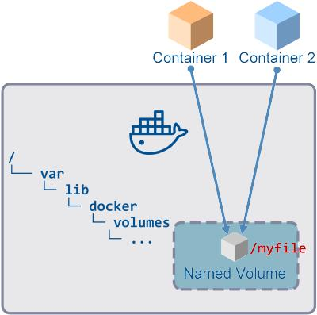
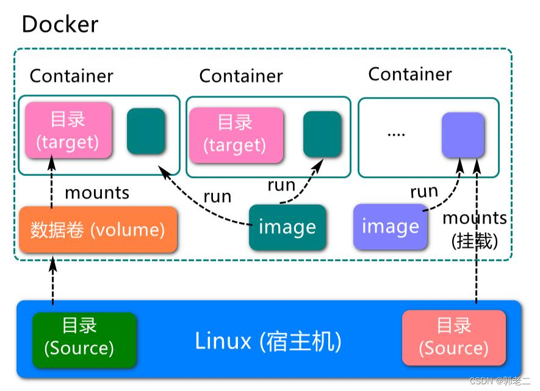
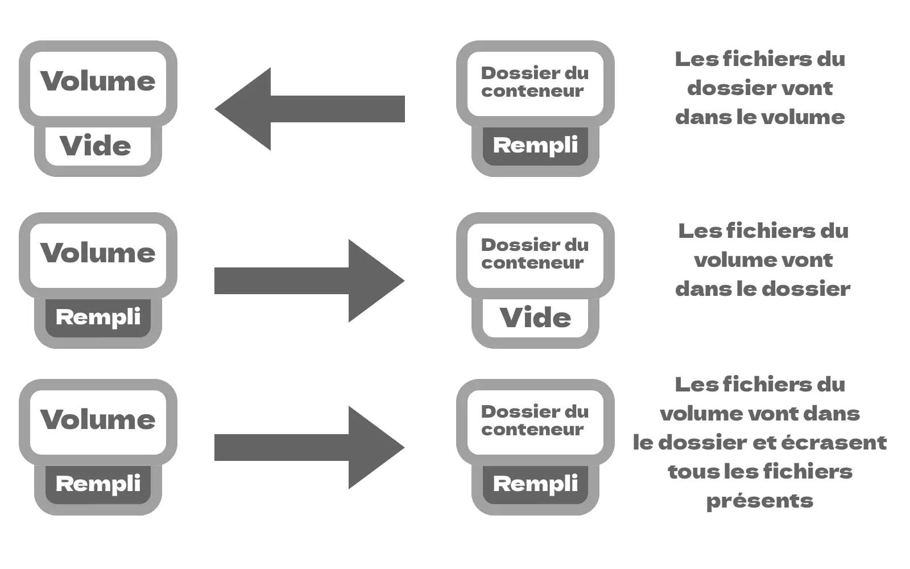
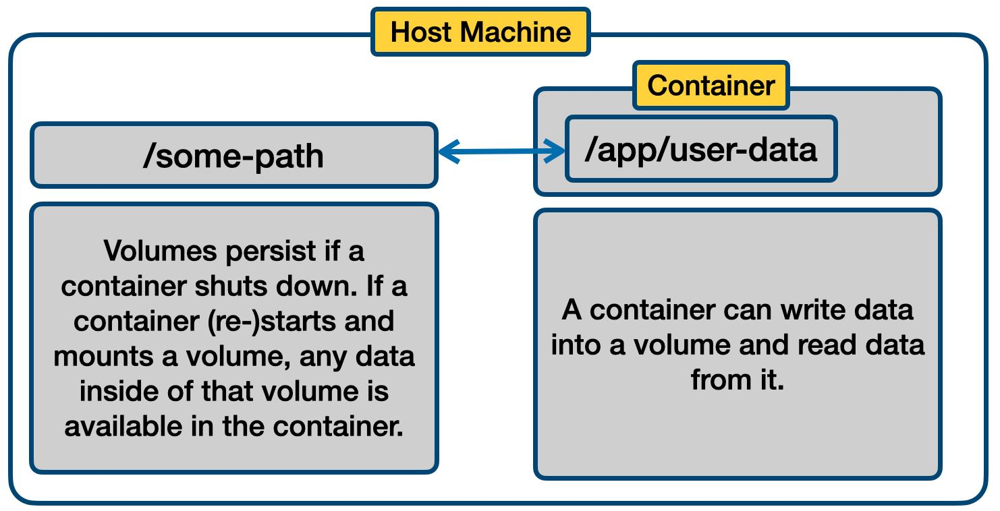

# Hands-on Docker-03: Handling Docker Volumes

## Overview

Docker containers are designed to be temporary. When a container is removed, the data stored in its writable layer is also removed. Docker volumes allow us to persist data independently of a container's lifecycle.

In this lesson, we will learn how to create and manage Docker volumes, share data between containers, use read-only volumes, work with bind mounts, and understand anonymous volumes.

## 1. Data Persistence in Containers

First, let's create an Alpine Linux container and write some data inside it.

```bash
docker run -it --name alpine-container alpine sh
```

Inside the container, create a file:

```sh
echo "Hello from Docker container" > /data.txt
cat /data.txt
```

Exit the container:

```sh
exit
```

Check the container:

```bash
docker ps -a
```

Start the container again:

```bash
docker start -ai alpine-container
```

Check the file:

```sh
cat /data.txt
```

The file still exists because the container was stopped and started again, not removed.

Exit and remove the container:

```sh
exit
```

```bash
docker rm alpine-container
```

If the container is removed, its writable-layer data is removed with it. To preserve data independently of a container, we can use a Docker volume.

## 2. Creating and Inspecting a Named Volume

Create a named volume:

```bash
docker volume create my-volume
```

List available volumes:

```bash
docker volume ls
```

Inspect the volume:

```bash
docker volume inspect my-volume
```

Docker manages the volume and stores its data outside the container's writable layer.

## 3. Using a Volume in a Container

Start an Alpine container and mount the named volume at `/data`:

```bash
docker run -it --name alpine-volume-1 \
  -v my-volume:/data alpine sh
```

Create a file inside the mounted directory:

```sh
echo "This data is stored in a Docker volume" > /data/message.txt
cat /data/message.txt
```

Exit the container:

```sh
exit
```

Remove the container:

```bash
docker rm alpine-volume-1
```

Create another container using the same volume:

```bash
docker run -it --name alpine-volume-2 \
  -v my-volume:/data alpine sh
```

Read the previously created file:

```sh
cat /data/message.txt
```

The data is still available because the volume exists independently of the first container.

## 4. Sharing One Volume Between Different Containers

A single named volume can be mounted by multiple containers. This allows containers to access the same stored data.

For example, start the first container:

```bash
docker run -dit --name container-1 \
  -v my-volume:/data alpine sh
```

Write a file:

```bash
docker exec container-1 sh -c \
  'echo "Shared data between containers" > /data/shared.txt'
```

Start a second container with the same volume:

```bash
docker run -dit --name container-2 \
  -v my-volume:/data alpine sh
```

Read the file from the second container:

```bash
docker exec container-2 cat /data/shared.txt
```

The second container can read the file created by the first container because both containers mount `my-volume` at `/data`.



**Important:** Multiple containers can access the same volume. If they modify the same files, consider how concurrent changes may affect your application.

## 5. Mounting a Volume as Read-Only

Sometimes a container needs to read data without modifying it. You can mount a volume in read-only mode by adding `:ro`.

```bash
docker run -dit --name readonly-container \
  -v my-volume:/data:ro alpine sh
```

Read the data:

```bash
docker exec readonly-container cat /data/shared.txt
```

Try to create a file inside the mounted directory:

```bash
docker exec readonly-container sh -c \
  'echo "This should fail" > /data/new-file.txt'
```

The write operation should fail because the volume is mounted as read-only.

Remove the container when finished:

```bash
docker rm -f readonly-container
```

## 6. Understanding Volume Initialization Behavior

When a volume is mounted into a container, Docker's behavior depends on whether the volume already contains data and whether the target directory in the container image already contains files.

### Situation 1: An empty volume and a non-empty container directory

If an empty volume is mounted over a directory that already contains files in the image, Docker normally copies the existing directory contents into the empty volume.

### Situation 2: A non-empty volume and a container directory

If the volume already contains data, that data is visible at the mount point. The volume's contents take precedence over the files that would otherwise be visible in the container directory.



### Situation 3: Using `volume-nocopy`

You can prevent Docker from copying existing image-directory contents into an empty volume by using the `volume-nocopy` option.

Example:

```bash
docker run -it --name no-copy-container \
  --mount type=volume,source=my-volume,target=/data,volume-nocopy \
  alpine sh
```

This option is useful when you want to avoid automatically populating a volume with files from the image.



### Situation 4: Inspecting the result

The files visible inside the container depend on the contents of the volume and the mount configuration. Inspect the mounted directory and compare it with the original image directory to understand which data is available.



## 7. Using Bind Mounts

A bind mount connects a specific file or directory on the host machine to a path inside a container.

Unlike named volumes, bind mounts use a host path that you specify.

For example, create a directory and an HTML file on the host:

```bash
mkdir -p ~/docker-nginx/html
echo "<h1>Hello from a bind mount!</h1>" > ~/docker-nginx/html/index.html
```

Run an Nginx container and mount the host directory:

```bash
docker run -d --name nginx-bind-mount \
  -p 8080:80 \
  --mount type=bind,source="$HOME/docker-nginx/html",target=/usr/share/nginx/html,readonly \
  nginx
```

Open the following address in your browser:

```text
http://localhost:8080
```

You should see the HTML content from the host directory.

If Docker is running on a remote server, replace `localhost` with that server's accessible address and ensure the port is reachable.

Because the mount is read-only, the container can read the host files but cannot modify them through this mount.

Remove the container when finished:

```bash
docker rm -f nginx-bind-mount
```

## 8. Anonymous Volumes

Docker can create an anonymous volume when a volume is mounted without specifying a volume name, depending on the command and image configuration.

Example:

```bash
docker run -d --name anonymous-volume-container \
  -v /app/data alpine sleep 3600
```

List volumes:

```bash
docker volume ls
```

Inspect the container's mounts:

```bash
docker inspect anonymous-volume-container
```

Anonymous volumes have automatically generated names. They can be useful when an application needs persistent storage but a specific volume name is not required.

### Anonymous Volumes and `--rm`

The `--rm` option automatically removes a container when it exits. Anonymous volumes associated with a container started using `--rm` are also removed automatically when the container is removed.

Example:

```bash
docker run --rm -v /app/data alpine sh -c \
  'echo "Temporary data" > /app/data/message.txt'
```

After the command exits, the container is removed. Its associated anonymous volume is also removed.

By contrast, removing a container without `--rm` does not automatically remove its anonymous volumes in every case. You may need to remove unused volumes separately.

## 9. Useful Docker Volume Commands

| Command | Description |
|---|---|
| `docker volume create my-volume` | Creates a named volume |
| `docker volume ls` | Lists volumes |
| `docker volume inspect my-volume` | Shows volume details |
| `docker volume rm my-volume` | Removes a volume |
| `docker volume prune` | Removes unused local volumes after confirmation |
| `docker inspect container-name` | Shows container configuration, including mounts |

**Warning:** Removing a volume permanently deletes its stored data. Before using `docker volume rm` or `docker volume prune`, make sure the data is no longer needed.

## 10. Cleanup

Remove the containers created during this lesson if they still exist:

```bash
docker rm -f alpine-volume-2 container-1 container-2 \
  no-copy-container anonymous-volume-container 2>/dev/null
```

Remove the named volume only if you no longer need its data:

```bash
docker volume rm my-volume
```

Check the remaining volumes:

```bash
docker volume ls
```

## Conclusion

In this lesson, we learned how to:

- Understand why container writable-layer data is not suitable for long-term persistence.
- Create, list, and inspect named Docker volumes.
- Preserve data when containers are removed.
- Share one volume between multiple containers.
- Mount volumes in read-only mode.
- Understand how Docker initializes volumes at mount points.
- Use bind mounts to access host files from containers.
- Work with anonymous volumes and understand the effect of `--rm`.

Docker volumes and bind mounts are important tools for managing persistent data and sharing files between the host and containers.
